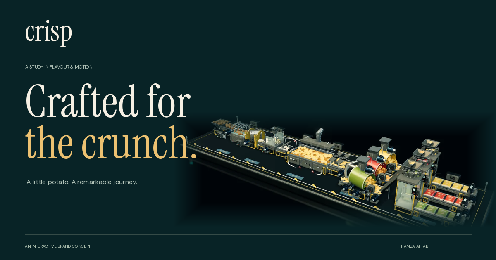

# CRISP — Crafted for the crunch.

An original potato-chip brand concept and interactive factory experience by **Hamza Aftab**. Built with vanilla JavaScript, Three.js and Vite. All machinery, food geometry, textures, choreography and audio are created in code.



## The experience

- A stainless-steel miniature factory with framed wash windows, a perforated abrasive peeler, an enclosed centrifugal cutter, a hooded continuous fryer, oil-drain conveyors, seasoning drums and three packaging lines.
- An end-of-line sequence with inspection arches, vacuum bag transfer, labelled corrugated cartons, folding flaps, tape heads, roller outfeeds and finished boxes on slatted wooden pallets.
- A scroll-directed camera journey through five processes. Process buttons also jump to any step.
- Three selectable flavours: Golden Sea Salt, Smoky Paprika and Garden Herbs. The same renderer switches from the factory to sculpted product packaging.
- Original stereo procedural foley: filtered water, wet slicing, layered oil crackle, chip rustle, pneumatic contact, film movement and carton handling. Optional sparse felt-key music. Audio starts only after a visitor enables it and stays on the animation's clock. Sound layers crossfade as the camera moves, with short fades when playback starts or stops.
- Desktop and mobile layouts, an accessible mobile menu, keyboard camera inspection, reduced-motion support and still-image fallbacks.
- Local fonts and assets. Rendering and machine audio stop while the experience is offscreen or the tab is hidden.

This is a portfolio concept. The collection presents fictional packaging and flavours; the site does not process orders. The creator button opens Hamza's GitHub profile.

## Deploy to Vercel

1. Open [Vercel's new project page](https://vercel.com/new) and import **hamzaaftab325-eng/potato-factory-**.
2. Use the repository root and the `main` branch.
3. Confirm these settings, then deploy:

| Setting               | Value           |
| --------------------- | --------------- |
| Framework preset      | Vite            |
| Root directory        | Repository root |
| Node.js               | 24.x            |
| Install command       | `npm ci`        |
| Build command         | `npm run build` |
| Output directory      | `dist`          |
| Environment variables | None required   |

`vercel.json` already sets the framework, build command, output directory, immutable caching for generated assets, and response headers. The page uses anchor navigation, so no SPA rewrite is necessary. Vercel's Git integration can build future commits automatically.

After your domain is assigned, set `og:image` in `index.html` to the absolute public URL of `/social-preview.png` and add a canonical link for that domain. The relative preview image is included now, without inventing a domain.

Official references: [Vite on Vercel](https://vercel.com/docs/frameworks/frontend/vite), [supported Node versions](https://vercel.com/docs/functions/runtimes/node-js/node-js-versions).

## Run locally

Install Node.js 24, then:

```sh
npm ci
npm run dev
```

Open `http://localhost:4173`. A web server is required for ES modules; opening `index.html` as a local file will not load the application.

```sh
npm test          # Functional, geometry, camera-path and audio checks
npm run build    # Production assets in dist/
npm run preview  # Serve the production build locally
```

## Source guide

| File                      | Purpose                                                                     |
| ------------------------- | --------------------------------------------------------------------------- |
| `index.html`              | Page content, SEO metadata and semantic controls                            |
| `src/styles.css`          | Typography, layout, materials palette and responsive design                 |
| `src/lib/page.js`         | Navigation, sound controls, flavour selection and scene placement           |
| `src/lib/journey.js`      | Scroll progression, camera presets and flavour metadata                     |
| `src/factory/scene.js`    | Lighting, machinery, animation, postprocessing and product view             |
| `src/factory/details.js`  | Drum and bagger engineering, weighers and secondary movement                |
| `src/factory/machines.js` | Washer, peeler, centrifugal cutter, hooded fryer and connected transfers    |
| `src/factory/shipping.js` | Vacuum heads, carton choreography, flap closing, taping and pallets         |
| `src/factory/surfaces.js` | Brushed metal, perforations, food skin, belt, kraft paper and wood textures |
| `src/factory/timing.js`   | Shared loop, knife, sealing-jaw and carton timing                           |
| `src/factory/geometry.js` | Curved chips and inflated, crimped film geometry                            |
| `src/factory/audio.js`    | The six procedural sound layers                                             |
| `public/`                 | Factory still, vector packaging, social image and favicon                   |
| `tests/`                  | Automated checks                                                            |
| `archive/`                | The previous repository prototype, preserved for reference                  |

Change the brand copy and profile links in `index.html`. Flavour names/colours and camera framing are in `src/lib/journey.js`; procedural label artwork is in `bagMaterial()` in `src/factory/scene.js`. Update the HTML flavour descriptions and fallback SVG packs alongside any flavour changes.

The still factory poster is a crop of the previous code-rendered scene; it has not yet been refreshed for the revised machinery. It provides immediate content and a fallback; the interactive experience renders real geometry, with no video backdrop or remote model downloads.

## Current revision

The machinery and audio refinement is implemented in source. **No QA, automated tests, production build or browser/audio review was run for this revision, at the owner's request.** The existing checks remain available through `npm test` and `npm run build`; GitHub's existing workflow will run when commits are pushed.

The mechanical models are an original, compact portfolio interpretation, not a manufacturing simulation. Design references include [Urschel's enclosed centrifugal slicer](https://www.urschel.com/cutting-machines/model-cc-slicer/) and [Heat and Control's continuous potato-chip fryer](https://www.heatandcontrol.com/model/potato-chip-fryer). No manufacturer models, logos or audio have been copied.

All animation repeats on a 16-second clock. A bag cycle takes two seconds and a carton cycle takes eight seconds; the three flavour lines are phase-offset. `timing.js` owns those timing values. The sound is synthesized from band-limited noise, shaped transient envelopes and short stereo reflections, with no stock recordings. The optional music is an original procedural arrangement.

## Dependency credits

Three.js is MIT licensed. Instrument Serif and DM Sans are distributed under the SIL Open Font License. Their license texts are included in `docs/licenses/`. No stock audio, external HDR maps, paid models or external image services are required.

## Scroll layout restoration

The active entry is `src/main.js`. The earlier sticky factory view and scroll-driven process chapters have been restored, with the original collection layout and camera framing. Current machinery and packaging models are retained. The React entry and its components remain in the repository for future work, but are not mounted by this page. The build uses Vite directly. No preview, build, tests or visual QA were run for this restoration, as requested.
